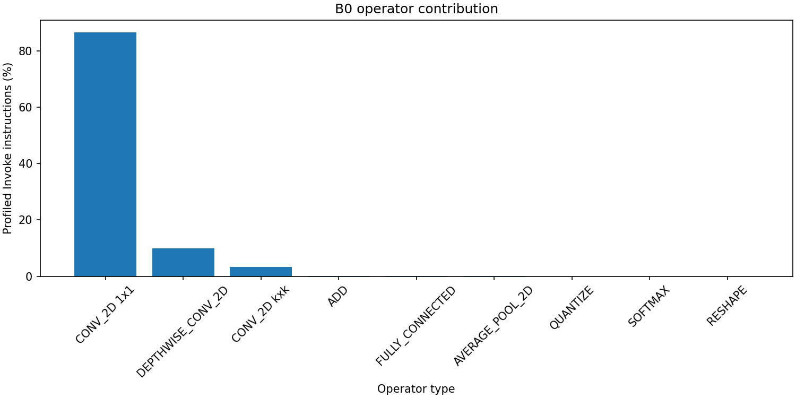
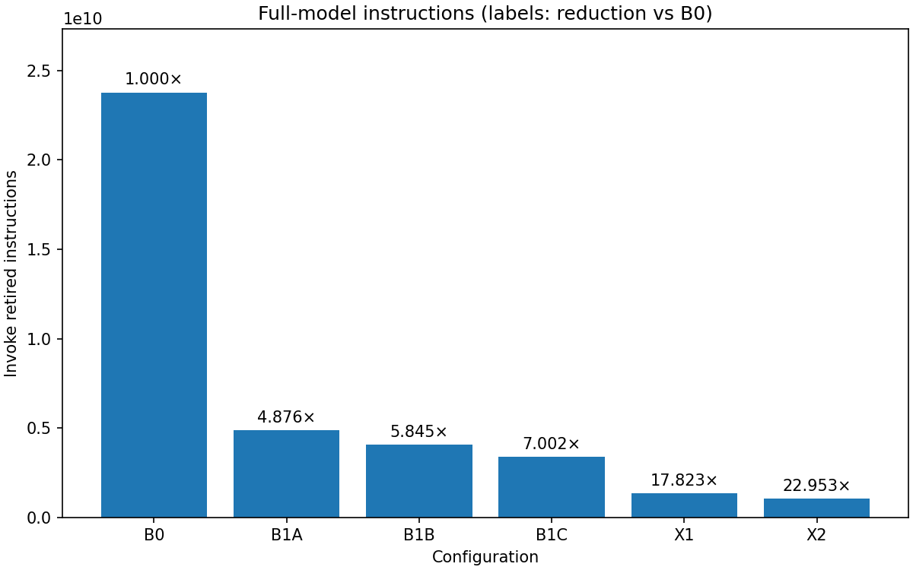

# Experiments

All numbers below are generated by `scripts/run_all.sh` into `results/` at commit `0c0f122`, with a clean tree
(`git_dirty = False` in every CSV). See [README.md](README.md) for the commands and [DESIGN.md](DESIGN.md) for
the rationale behind each configuration.

## 1. Methodology

| Item | How |
|---|---|
| Platform | Spike (pinned commit), `--isa=rv64imc`, bare-metal (no proxy kernel); X configs add the Xqmac extension library |
| Workload | EfficientNet-Lite0 INT8, full model, one inference; three fixed inputs (a photograph and two seeded random images) |
| Headline metric | Dynamic (retired) instructions around `Invoke()`, read with `rdinstret` |
| Per-operator counts | `rdinstret` around each operator, in a separate profiling build. The per-operator sum matches the unprofiled headline to within 0.0002% |
| Instruction mix | Spike PC histogram × disassembly classification (load, store, ALU, mul, branch, jump, custom). The histogram total is cross-checked against `minstret` |
| MACs | Computed analytically from the model graph: 385,187,552 per inference |
| Code size | Linked `.text` of runtime + kernels (the read-only model data is reported separately) |
| Correctness gate | Every run compares all 1,000 output bytes to LiteRT `BUILTIN_REF`. A config's numbers are written only if this passed in the same run |

Spike is an ISA simulator. These are instruction counts, not cycles; the cycle-level evaluation happens in the
final phase on CV-Wally RTL.

## 2. Baseline profile (B0)

B0 = TFLite Micro reference kernels, default build: **23.76 G instructions per inference, 61.7 instructions per MAC.**

| Operator type | Share of instructions | Instr/MAC |
|---|--:|--:|
| CONV_2D 1×1 (32 layers) | 86.7% | 60.85 |
| DEPTHWISE_CONV_2D (16) | 9.9% | 68.08 |
| CONV_2D k×k (stem) | 3.3% | 71.50 |
| FULLY_CONNECTED | 0.05% | 9.05 |
| Others (ADD, pool, softmax, …) | 0.1% | – |

Instruction mix: ALU 39.1%, branch 31.5%, load 17.6%, mul 11.2%, store 0.4%; 11.1 loads + stores per MAC.
The high branch share comes from the conv inner loop, which spends 59 instructions per MAC:

- 37 debug-only index checks (`TFLITE_DCHECK`, active because `NDEBUG` is not defined)
- 14 address recomputations
- 5 instructions of actual MAC work
- 3 loop control

## 3. Software optimization (B1a → B1c)

| Config | Change | Instructions | × vs previous | × vs B0 |
|---|---|--:|--:|--:|
| B1a | Release build (`-DNDEBUG`) | 4,873,990,558 | 4.88 | 4.88 |
| B1b | Depthwise interior/border split | 4,065,900,906 | 1.20 | 5.84 |
| B1c | Input offset folded into bias (1×1, FC) | 3,393,991,551 | 1.20 | 7.00 |

- **B1a.** Without the checks, the compiler also hoists the address math out of the loop. 1×1 conv drops from 60.9
  to 9.7 instr/MAC. Depthwise drops only to 37.6, because its per-tap padding check is real logic that survives
  `NDEBUG`.
- **B1b.** Depthwise drops from 37.6 to 14.2 instr/MAC.
- **B1c.** 1×1 conv drops from 9.7 to 7.75 and FC from 9.0 to 7.0 instr/MAC.

## 4. Top-3 bottlenecks (after software optimization, B1c)

With software optimization done, the B1c profile shows what plain RV64IMC cannot fix:

| # | Bottleneck | Evidence (B1c) | Why software can't remove it |
|---|---|---|---|
| 1 | **INT8 MAC loop in 1×1 conv / FC** | 77.3% of instructions; 7.75 instr/MAC. Each MAC needs 2 byte loads, a multiply, an add and loop overhead; 2.28 loads + stores per MAC | RV64IMC has no sub-word SIMD: one 64-bit register holds 8 int8 values, but the ISA can only multiply one pair at a time |
| 2 | **Requantization** | `MultiplyByQuantizedMultiplier` alone = 246 M instructions (7.3%). Full sequence ≈ 52 instr/output (microbench) × 6.34 M outputs ≈ 0.33 G ≈ 10% of B1c | A 64-bit multiply, rounding high-half, rounding shift, zero-point add and two clamps, all bit-exact. It is a fixed chain of dependent scalar ops |
| 3 | **Depthwise convolution** | 14.4% of instructions at 14.2 instr/MAC (vs 7.75 for 1×1) | Only 9 or 25 MACs per output, so per-output costs (requantization, loop setup) are amortized poorly. A packed dot product doesn't apply, because each channel is its own sum |

**Amdahl's law sets the order.** Bottleneck 1 is three quarters of the time, so `qmac8` comes first. Once
the MAC loop is cheap, bottlenecks 2 and 3 become the largest remaining costs, and `rqnt` addresses both (requantization
is part of every depthwise output).

The stem k×k conv (7.3%) stays on the TFLM reference kernel: it is a single layer with only 3 input channels.

## 5. Custom instructions (X1, X2)

| Config | Instructions | Instr/MAC | × vs previous | × vs B0 | Custom-instr count |
|---|--:|--:|--:|--:|--:|
| B1c | 3,393,991,551 | 8.81 | – | 7.00 | – |
| X1 = B1c + `qmac8` | 1,333,373,407 | 3.46 | **2.55** | 17.82 | 42.5 M `qmac8` |
| X2 = X1 + `rqnt` | 1,035,349,510 | 2.69 | **1.29** | **22.95** | 42.5 M `qmac8` + 6.34 M `rqnt` |

Per operator (instr/MAC):

| Operator | B1c | X1 | X2 |
|---|--:|--:|--:|
| CONV 1×1 | 7.75 | 1.69 | 1.13 |
| FC | 7.05 | 0.93 | 0.89 |
| DEPTHWISE | 14.17 | 14.17 | 11.02 |
| CONV k×k (unchanged) | 22.79 | 22.79 | 22.79 |

- **X1: bottleneck 1.** The 1×1 conv inner loop becomes `ld, ld, qmac8, addi, addw, addi, bne`: 7 instructions per
  8 MACs (≈ 0.88 instr/MAC, matching the microbenchmark). 1×1 conv gets 4.6× faster. Loads + stores per MAC drop from
  2.28 to 0.74. After X1, the profile shifts as Amdahl's law predicts: 1×1 conv = 43%, depthwise = 37%,
  requantization ≈ 25%.
- **X2: bottlenecks 2 and 3.**
  - Requantization goes from 52.2 to 8.0 instr/output (microbench, which includes loads and stores). Inside that,
    a scalar chain of about 44 instructions per output becomes one `rqnt`.
  - All 49 requantizing layers use `rqnt`.
  - Depthwise drops from 14.2 to 11.0 and 1×1 conv from 1.69 to 1.13 instr/MAC.
  - The measured X1→X2 saving (298 M instructions) agrees with the bottleneck-2 estimate (≈ 6.34 M outputs ×
    44 saved).
- **Cost.** Linked code grows by 1.2 KB (87,460 → 88,696 B). The packed requant parameter table is 168 KB (8 B per
  output channel), built once at setup.

### Microbenchmarks (`results/microbench.csv`)

| Kernel (1,280 elements) | Scalar RV64IMC | Custom | Reduction |
|---|--:|--:|--:|
| INT8 dot product | 7.01 instr/MAC | 0.88 instr/MAC | 7.9× |
| Requantization | 52.19 instr/output | 8.01 instr/output | 6.5× |

## 6. Remaining bottlenecks (X2)

| Operator type | Share | Instr/MAC |
|---|--:|--:|
| CONV 1×1 | 36.9% | 1.13 |
| DEPTHWISE | 36.7% | 11.02 |
| CONV k×k (stem, reference kernel) | 23.9% | 22.79 |
| ADD and others | 2.5% | – |

The work is now spread evenly over three operator types:
- 1×1 conv is close to the 0.875 instr/MAC floor of a load-load-MAC-add loop. Going further needs fewer loads or
  less loop overhead per MAC, e.g. register blocking, post-increment loads or hardware loops (final-phase extension
  candidates).
- Depthwise is limited by its scalar MAC loop and by per-output overhead.
- The stem conv still runs the reference kernel.

## 7. Correctness

Every configuration is bit-exact with LiteRT `BUILTIN_REF` on all three inputs (0 differing output bytes; the
photograph is classified as class 652 by every config).
- `qmac8` and `rqnt` pass their directed and 10,000-vector random tests against the Python golden models on Spike,
  as do their C fallbacks.
- Both trap as illegal instructions on plain RV64IMC.
- The optimized kernels match the TFLM reference kernels on every real layer shape.
- No F/D/A/V instruction appears in any ELF.
