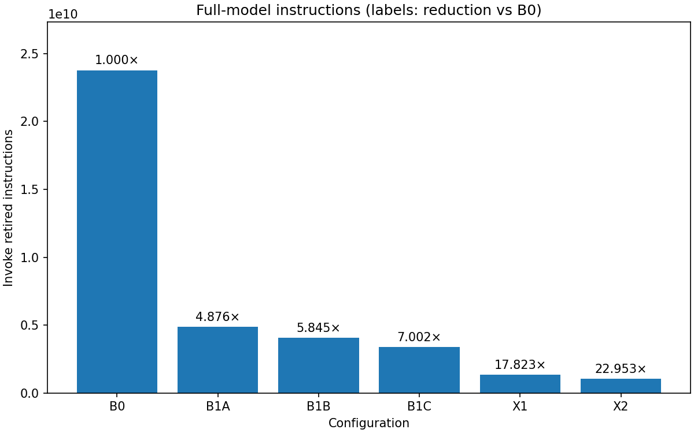

# Quantized Neural-Network Acceleration on RV64IMC (CV-Wally)

Architectural extensions for accelerating INT8 (W8A8) neural-network inference on a bare-metal
RV64IMC RISC-V processor. The midterm phase evaluates them at the ISA level on Spike; the final phase
implements them in CV-Wally RTL.

**Workload:** EfficientNet-Lite0 INT8 (unmodified), TFLite Micro, bare-metal, no OS, no FP.
**Extensions (Xqmac):** `qmac8` (8-lane INT8 dot product) and `rqnt` (one-instruction requantization).
**Headline:** full-model inference goes from 23.76 G to 1.035 G retired instructions (**22.95× fewer**),
bit-exact with the LiteRT reference interpreter.

| Document | Contents |
|---|---|
| [Slides (midterm)](#slides) | 5–6 minute midterm presentation |
| [DESIGN.md](DESIGN.md) | Design decisions, alternatives considered, and why |
| [EXPERIMENTS.md](EXPERIMENTS.md) | Methodology, bottleneck analysis, results |
| [docs/isa_xqmac.md](docs/isa_xqmac.md) | `qmac8` / `rqnt` encodings and exact semantics |
| [AI_USAGE.md](AI_USAGE.md) | Use of AI tools in this project |

## Repository layout

| Path | Contents |
|---|---|
| `src/runtime/` | Bare-metal runtime: `crt0.S`, linker script, HTIF console/exit, `rdinstret` helpers |
| `src/app/` | TFLite Micro application (op resolver, static arena, per-operator profiler) |
| `src/kernels/` | Optimized kernels (1×1 conv, FC, depthwise) and `xqmac.h` (instruction wrappers + C fallbacks) |
| `src/spike_ext/` | Spike extension library implementing `qmac8` and `rqnt` (+ disassembly) |
| `src/tests/` | Bare-metal runtime tests, instruction tests, kernel tests, microbenchmarks |
| `scripts/` | Toolchain setup, model download/re-pack, golden models, test and benchmark drivers, analysis |
| `experiments/` | Build configurations B0, B1a, B1b, B1c, X1, X2 (`order.txt` = run order) |
| `results/` | Generated CSVs, summaries and plots (never edited by hand) |

## Quick start

Linux x86_64. Everything is pinned in `scripts/versions.env` (GCC, Spike commit, TFLM commit,
model URL + SHA256).

1. **Toolchain.** Pinned xPack RISC-V GCC, Spike built from a pinned commit, the Xqmac extension
   library (`libxqmac.so`) and the Python packages. Installed under `$HOME/opt/cvwally` (override with `TOOLS_DIR`):

   ```bash
   sudo apt-get install build-essential device-tree-compiler curl git python3 python3-venv
   scripts/setup_toolchain.sh
   source scripts/env.sh
   python3 -m pip install -r scripts/requirements.txt
   ```

2. **Model and runtime.** Download the EfficientNet-Lite0 INT8 model (checked by SHA256), re-pack it so every
   weight buffer is 16-byte aligned (tensor bytes unchanged; the interpreter output is verified identical), and
   fetch the pinned TFLite Micro tree:

   ```bash
   scripts/get_model.py
   scripts/get_tflm.sh
   ```

3. **Short tests** (a few minutes). These check:
   - bare-metal runtime tests
   - `qmac8` and `rqnt` against their Python golden models (directed edge cases + 10,000 fixed-seed random vectors
     each), and the C fallbacks
   - `qmac8`/`rqnt` trap as illegal instructions on plain `--isa=rv64imc`
   - optimized kernels bit-exact against the TFLM reference kernels on every real layer shape
   - an objdump scan proving that no F/D/A/V instructions exist in any ELF
   - the full model for every config, bit-exact against LiteRT `BUILTIN_REF`

   ```bash
   scripts/run_tests.sh        # prints PASS/FAIL per check, non-zero exit on any failure
   ```

4. **Full benchmark** (about 30 minutes with `JOBS=4`). Builds every config in `experiments/order.txt`, then runs:
   - the full model on three fixed inputs (photograph + two seeded random images), each bit-exact checked
   - the profile of each config (per-operator `rdinstret`, instruction mix from the Spike PC histogram, memory
     instructions, MAC/instr, code size, custom-instruction counts)
   - the microbenchmarks
   - the config comparison

   ```bash
   scripts/run_all.sh          # → results/*.csv, results/*_profile_summary.md, results/plots/*.png
   ```

   Single config: `make -j8 CONFIG=x2 && scripts/check_model.py --config x2 --all && scripts/profile.py --config x2`.

Every program runs bare-metal on `spike --isa=rv64imc` (no proxy kernel). The X configs add
`--extlib=libxqmac.so --extension=xqmac`. Retired instructions are measured with `rdinstret` around
`Invoke()` only. They are ISA-level counts, not cycle estimates. A config's numbers are written only if
its bit-exact check passed in the same run. Each result row records the git commit, dirty flag and tool pins.

## Expected results

Full-model inference, photograph input (`results/configs.csv`, commit `0c0f122`).
Total MACs = 385,187,552 (computed from the model graph). The two random inputs differ by less than
0.001% in instruction count.

| Config | Change | Dyn. instructions (`Invoke`) | Instr/MAC | × vs B0 | × vs previous |
|---|---|--:|--:|--:|--:|
| B0 | TFLM reference kernels, default build | 23,764,202,246 | 61.70 | 1.00 | – |
| B1a | B0 + release build (`-DNDEBUG`) | 4,873,990,558 | 12.65 | 4.88 | 4.88 |
| B1b | B1a + depthwise without per-tap checks | 4,065,900,906 | 10.56 | 5.84 | 1.20 |
| B1c | B1b + input offset folded into bias (1×1 conv, FC) | 3,393,991,551 | 8.81 | 7.00 | 1.20 |
| X1 | B1c + `qmac8` in 1×1 conv and FC | 1,333,373,407 | 3.46 | 17.82 | 2.55 |
| X2 | X1 + `rqnt` in 1×1 conv, FC and depthwise | 1,035,349,510 | 2.69 | 22.95 | 1.29 |

Per-operator instructions per MAC, memory traffic and code size:

| Config | CONV 1×1 | DEPTHWISE | CONV k×k | FC | ld+st / MAC | custom-instr share | linked `.text` (B) |
|---|--:|--:|--:|--:|--:|--:|--:|
| B0 | 60.85 | 68.08 | 71.50 | 9.05 | 11.10 | 0.0% | 92,168 |
| B1a | 9.73 | 37.57 | 22.79 | 9.05 | 3.25 | 0.0% | 84,512 |
| B1b | 9.73 | 14.17 | 22.79 | 9.05 | 2.65 | 0.0% | 85,628 |
| B1c | 7.75 | 14.17 | 22.79 | 7.05 | 2.28 | 0.0% | 87,460 |
| X1 | 1.69 | 14.17 | 22.79 | 0.93 | 0.74 | 3.1% | 87,820 |
| X2 | 1.13 | 11.02 | 22.79 | 0.89 | 0.65 | 4.5% | 88,696 |

Microbenchmarks (`results/microbench.csv`, 1,280 elements):

| Kernel | Scalar RV64IMC | With custom instruction |
|---|--:|--:|
| INT8 dot product | 7.01 instr/MAC | 0.88 instr/MAC (`qmac8`) |
| Requantization | 52.19 instr/output | 8.01 instr/output (`rqnt`) |



## Slides

Midterm slides (Google Slides): _link added on publication_.
